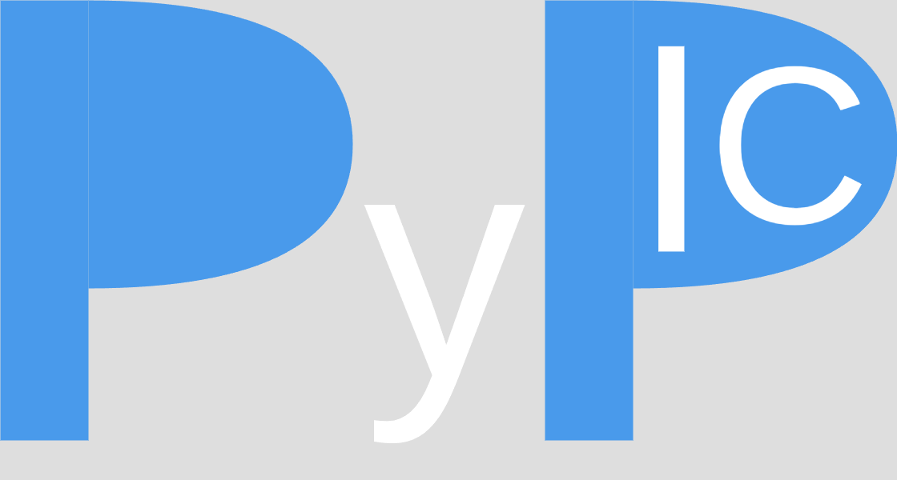

<div align="center">
  
</div>

## PyPIC3D

PyPIC3D is a three-dimensional particle-in-cell plasma simulation code written
in Python with JAX. The production runtime keeps fields and particles in a
shared tile layout and is configured through TOML:

```bash
PyPIC3D --config path/to/config.toml
```

## What It Does

- Pushes tile-local particle species with Boris or Higuera-Cary methods.
- Deposits current with direct `j_from_rhov` or charge-conserving Esirkepov
  deposition.
- Evolves electromagnetic fields with a staggered Yee update or solves the
  electrostatic Poisson problem.
- Exchanges field halos and moving particles across a JAX device mesh.
- Writes energy and momentum traces plus optional asynchronous openPMD field
  and particle output.

## Installation

From PyPI:

```bash
pip install PyPIC3D
```

From source:

```bash
git clone <repo-url>
cd PyPIC3D
pip install .
```

For development:

```bash
pip install -e .
```

## Quick Start

Run the single-tile two-stream demo from the repository root:

```bash
PyPIC3D --config demos/two_stream/two_stream.toml
```

Simulation outputs are written under `<output_dir>/data`. See the
[usage guide](docs/usage.rst) for the active TOML options and the
[tiling guide](docs/tiling.rst) before selecting a multi-tile layout.

## Documentation Map

The Sphinx documentation lives in `docs/`:

- `usage.rst`: CLI configuration, external fields, PML, and outputs.
- `tiling.rst`: tile geometry, device topology, guard cells, and particle
  capacity.
- `solvers.rst`: electrodynamic and electrostatic update paths.
- `chargeconservation.rst`: current deposition and filtering.
- `grid.rst`: coordinate grids, Yee staggering, and boundaries.
- `particles.rst`: species initialization and tiled particle state.
- [Pair injection](docs/pair_injection.md): optional compiled pair sources for the static-metric solver.
- `demos.rst`: runnable examples.
- `architecture.rst`: runtime objects, modules, and data flow.
- `development.rst`: setup, tests, documentation builds, and debugging.

## Repository Layout

```text
PyPIC3D/
  __main__.py                 # CLI and simulation driver
  initialization.py           # TOML defaults and runtime construction
  parameters.py               # static and dynamic NamedTuple parameters
  particles/                  # particle state, initialization, and retile communication
  pusher/                     # Boris and Higuera-Cary pushers
  deposition/                 # current, charge, and particle shape functions
  solvers/                    # algorithm-specific time loops and field updates
    electrostatic/            # electrostatic loop and Poisson solve
    yee/                      # electrodynamic loop and Yee updates
    gr_static/                # prescribed-metric loop and field updates
  boundary_conditions/        # ghost cells, conducting walls, and PML
  diagnostics/                # energy, fluid moments, plotting, and openPMD
  utilities/                  # grid construction and numerical filters

demos/                        # runnable configurations and initial conditions
tests/code_tests/             # focused implementation tests
tests/physics_tests/          # numerical and convergence tests
```

## Testing

A suite of lightweight API call and implementation tests can be run with:

```bash
python -m unittest tests/code_tests/*.py
```

A suite of lightweight physics based tests to verify the correctness of the implementation can be run with:

```bash
python -m unittest tests/physics_tests/*.py
```

## Build Docs

```bash
pip install -r docs/requirements.in
python -m sphinx -b html -W --keep-going docs docs/_build/html
```

## Next Stages ##
- [ ] 3+1 Curvilinear PIC with static metrics.
- [ ] 3+1 Curvilinear PIC with dynamic metrics using BSSN/Z4C.
- [ ] Harris Current Sheet Demonstration.
- [X] Orszag-Tang Vortex Demonstration.
- [ ] Refactoring deposition to use single stencil call for deposition and interpolation.
- [ ] Fixed mesh refinement for both standard and 3+1 curvilinear PIC.


## License

MIT. See `LICENSE`.
