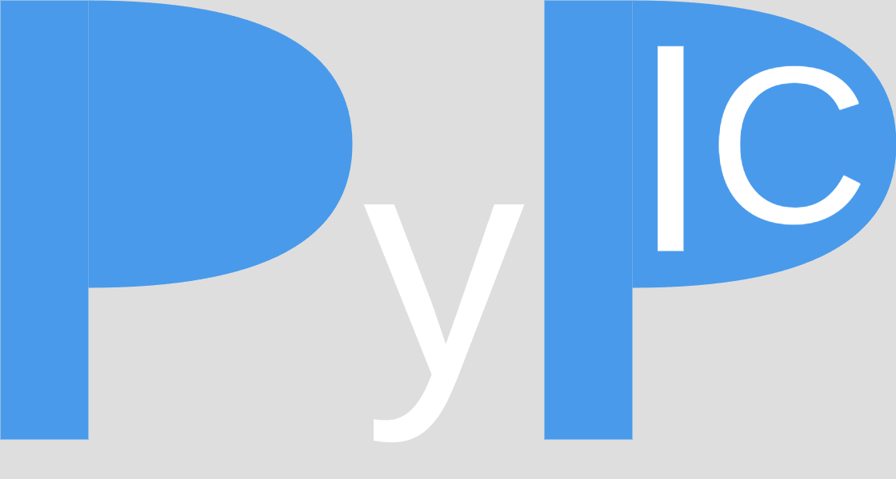

<div align="center">
  
</div>

## PyPIC3D

PyPIC3D is a three-dimensional particle-in-cell plasma simulation code written
in Python with JAX. The production runtime keeps fields and particles in a
shared tile layout and is configured through TOML:

```bash
PyPIC3D --config path/to/config.toml
```

## What It Does

- Pushes tile-local particle species with Boris or Higuera-Cary methods.
- Deposits current with direct `j_from_rhov` or charge-conserving Esirkepov
  deposition.
- Evolves electromagnetic fields with a staggered Yee update or solves the
  electrostatic Poisson problem.
- Exchanges field halos and moving particles across a JAX device mesh.
- Evolves a kinetically mixed Maxwell-Proca dark photon sector alongside the
  ordinary fields.
- Evolves the spacetime itself with BSSN numerical relativity, coupled to the
  plasma stress-energy, or pushes particles on a prescribed Kerr-Schild metric.
- Writes energy and momentum traces plus optional asynchronous openPMD field
  and particle output.

## Installation

From PyPI:

```bash
pip install PyPIC3D
```

From source:

```bash
git clone https://github.com/uwplasma/PyPIC3D.git
cd PyPIC3D
pip install .
```

For development:

```bash
pip install -e .
```

The dynamical-relativity solver needs the optional `JAX_BSSN` dependency. Its
tests and the `demos/dynamical_relativity/` examples skip or fail without it:

```bash
pip install -e '.[relativity]'
```

## Quick Start

Run the single-tile two-stream demo from the repository root:

```bash
PyPIC3D --config demos/standard_yee/two_stream/two_stream.toml
```

Simulation outputs are written under `<output_dir>/data`. See the
[usage guide](docs/usage.rst) for the active TOML options and the
[tiling guide](docs/tiling.rst) before selecting a multi-tile layout.

## Documentation Map

The Sphinx documentation lives in `docs/`:

- `usage.rst`: CLI configuration, external fields, PML, and outputs.
- `tiling.rst`: tile geometry, device topology, guard cells, and particle
  capacity.
- `solvers.rst`: overview of every solver and its update sequence.
- `dark_photon.rst`: the Maxwell-Proca dark sector, its mixing, and its
  configuration.
- `dynamical_relativity.rst`: the BSSN-PIC solver, the `[metric]` table, gauge
  conditions, and gravitational boundaries.
- `distributed_cartesian.rst`: multi-node coupled runs and openPMD merging.
- `pair_injection.rst`: optional compiled pair sources for the static-metric
  solver.
- `chargeconservation.rst`: current deposition and filtering.
- `grid.rst`: coordinate grids, Yee staggering, and boundaries.
- `particles.rst`: species initialization and tiled particle state.
- `demos.rst`: runnable examples.
- `architecture.rst`: runtime objects, modules, and data flow.
- `development.rst`: setup, tests, documentation builds, and debugging.

## Repository Layout

```text
PyPIC3D/
  __main__.py                 # CLI and simulation driver
  initialization.py           # TOML defaults and runtime construction
  particles/                  # particle state, initialization, and retile communication
  pusher/                     # Boris, Higuera-Cary, and hybrid Boris-geodesic
  deposition/                 # current, charge, and particle shape functions
  relativity/                 # 3+1 metrics, BSSN parameters, stress-energy
    metrics/                  # flat and Kerr-Schild analytic charts
  solvers/                    # algorithm-specific time loops and field updates
    electrostatic/            # electrostatic loop and Poisson solve
    yee/                      # electrodynamic loop and Yee updates
    GR_yee/                   # static-metric and dynamical-metric loops
    dark_matter_yee/          # Maxwell-Proca dark photon sector
  boundary_conditions/        # ghost cells, conducting walls, PML, and sponges
  diagnostics/                # energy, fluid moments, plotting, and openPMD
  utilities/                  # parameters, grid construction, and filters

demos/                        # runnable configurations and initial conditions
tests/code_tests/             # focused implementation tests
tests/physics_tests/          # numerical and convergence tests
tests/distributed_tests/      # multi-device and sharded-output tests
```

## Testing

Run each suite in its own interpreter so JAX initializes with the right device
count:

```bash
JAX_PLATFORMS=cpu JAX_ENABLE_X64=1 JAX_NUM_CPU_DEVICES=1 python -m unittest discover -s tests/code_tests -t . -p '*test*.py'
```

```bash
JAX_PLATFORMS=cpu JAX_ENABLE_X64=1 JAX_NUM_CPU_DEVICES=1 python -m unittest discover -s tests/physics_tests -t . -p '*test*.py'
```

```bash
JAX_PLATFORMS=cpu JAX_ENABLE_X64=1 JAX_NUM_CPU_DEVICES=8 python -m unittest discover -s tests/distributed_tests -t . -p '*test*.py'
```

See `docs/development.rst` for coverage contexts and timing guidance.

## Build Docs

```bash
pip install -r docs/requirements.in
python -m sphinx -b html -W --keep-going docs docs/_build/html
```

## Next Stages ##
- [X] Charged star collapse with dynamic metrics using BSSN.
- [ ] Charged puncture collapse with dynamic metrics using BSSN.
- [X] 3+1 Curvilinear PIC with static metrics.
- [X] 3+1 Curvilinear PIC with dynamic metrics using BSSN.
- [X] Kinetically mixed Maxwell-Proca dark photon sector.
- [X] Harris Current Sheet Demonstration.
- [X] Orszag-Tang Vortex Demonstration.
- [ ] Fixed mesh refinement for both standard and 3+1 curvilinear PIC.


## License

MIT. See `LICENSE`.
