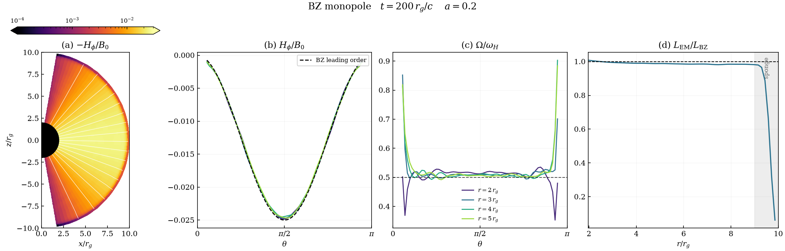

Demos
=====

Runnable examples live under ``demos/``, grouped into four families by solver:

.. list-table::
   :header-rows: 1
   :widths: 30 25 45

   * - Directory
     - Solver
     - Examples
   * - ``demos/standard_yee/``
     - ``electrodynamic_yee``
     - two-stream, Weibel, Orszag-Tang, Harris reconnection
   * - ``demos/dark_matter/``
     - ``dark_matter_yee``
     - dark two-stream, dark Harris reconnection
   * - ``demos/static_metric_relativity/``
     - ``static_metric``
     - Blandford-Znajek monopole, Kerr orbits, Wald/Meissner
   * - ``demos/dynamical_relativity/``
     - ``dynamic_metric``
     - OS collapse, charged stellar collapse, relativistic two-stream

Standard Yee
------------

Two-Stream Instability
~~~~~~~~~~~~~~~~~~~~~~

.. figure:: images/two_stream_vortex.png
   :alt: 1D phase-space density of two counter-streaming electron beams
   :align: center
   :width: 80%

   two-stream instability phase-space diagram.

The two-stream instability demo uses one tile:

.. code-block:: bash

   PyPIC3D --config demos/standard_yee/two_stream/two_stream.toml

Weibel Instability
~~~~~~~~~~~~~~~~~~

.. figure:: images/B_y_heatmap.png
   :alt: 1D magnetic field over time from the Weibel instability demo
   :align: center
   :width: 80%

   Weibel instability magnetic field evolution.

.. code-block:: bash

   PyPIC3D --config demos/standard_yee/weibel/weibel.toml

Orszag-Tang Vortex
~~~~~~~~~~~~~~~~~~

.. figure:: images/Ez_ot_shot.png
   :alt: Out-of-plane electric field from the Orszag-Tang vortex demo
   :align: center
   :width: 80%

   Orszag-Tang vortex out-of-plane electric field.

.. code-block:: bash

   cd demos/standard_yee/ot_vortex
   python initial_conditions.py
   PyPIC3D --config orszag_tang.toml

Harris-Sheet Reconnection
~~~~~~~~~~~~~~~~~~~~~~~~~

.. code-block:: bash

   cd demos/standard_yee/reconnection_2d
   python initial_data.py
   PyPIC3D --config harris_current.toml
   python analyze_data.py

Dark Sector
-----------

Both examples use ``solver = "dark_matter_yee"``. See :doc:`dark_photon` for
the field equations and the meaning of ``sin_chi`` and ``dark_mu``.

Dark Two-Stream Instability
~~~~~~~~~~~~~~~~~~~~~~~~~~~

A warm Maxwell--Proca two-stream instability in a 1D periodic box, with
``sin_chi = 0.3`` and ``dark_mu = 4``. The counter-streaming beams are neutral
in the visible sector, so the instability is driven through the mixing.

.. code-block:: bash

   cd demos/dark_matter/dark_two_stream
   python initial_data.py
   PyPIC3D --config dark_two_stream.toml

Dark Harris Reconnection
~~~~~~~~~~~~~~~~~~~~~~~~

An electron-positron Harris sheet whose reconnecting field is supplied
*entirely* through the dark sector. ``initial_data.py`` writes a dark vector
potential scaled by the inverse mixing, ``A' = -a_harris / sin_chi``, so that
the force shift ``-sin_chi * curl(A')`` reproduces the intended Harris field as
seen by the particles. The dark mass is set from the electron skin depth
(``dark_mu * d_e = 0.5``), and the z walls are conducting.

.. code-block:: bash

   cd demos/dark_matter/dark_reconnection_2d
   python initial_data.py
   PyPIC3D --config dark_harris.toml
   python analyze_data.py

``analyze_data.py`` compares the dark field, the ordinary field, and the
effective field ``B - sin_chi * dark_B`` that particles actually feel.

Static Metric
-------------

These use ``solver = "static_metric"`` with a prescribed chart. See the GR
Maxwell section of :doc:`solvers`.

Blandford-Znajek Monopole
~~~~~~~~~~~~~~~~~~~~~~~~~

A monopole magnetosphere around a spinning Kerr black hole in
horizon-penetrating spherical Kerr-Schild coordinates, following Entity
Paper II (Section 4.5).

.. code-block:: bash

   cd demos/static_metric_relativity/bz_monopole
   python run_bz_monopole.py
   python plot_bz.py

The demo uses the general static-metric finite-difference field updates and
standard metric-weighted E/H interpolation. Set ``theta_start`` and
``theta_end`` in radians; defaults are 10 and 170 degrees.

Kerr Orbits
~~~~~~~~~~~

A single neutral particle orbiting in spherical Kerr-Schild coordinates at
``metric_spin = 0.995``, integrated with ``hybrid_boris_geodesic``. It is the
cheapest check that the geodesic push and the metric sampler agree.

.. code-block:: bash

   cd demos/static_metric_relativity/kerr_orbits
   python run_kerr_schild_orbit.py

The runner loads ``kerr_schild.toml`` from its own directory and takes no
arguments.

Wald Field and the Meissner Effect
~~~~~~~~~~~~~~~~~~~~~~~~~~~~~~~~~~

The Wald solution for a spinning black hole immersed in a uniform magnetic
field, used to exhibit black-hole flux expulsion at high spin.

.. code-block:: bash

   cd demos/static_metric_relativity/meisser_effect
   python run_wald.py
   python analyze_data.py

``run_wald.py`` reads ``wald_demo.toml`` from its own directory. That file
carries its own ``[physics]`` and ``[grid]`` tables rather than the usual
``[simulation_parameters]`` schema.

Dynamical Relativity
--------------------

These use ``solver = "dynamic_metric"`` and require ``JAX_BSSN``:

.. code-block:: bash

   pip install -e '.[relativity]'

Each demo builds its geometry first with ``initial_metric.py``, then its
particles with ``initial_data.py``, then runs. See
:doc:`dynamical_relativity` for the ``[metric]`` table these configurations
use.

Oppenheimer-Snyder Dust Collapse
~~~~~~~~~~~~~~~~~~~~~~~~~~~~~~~~

Neutral pressureless dust collapsing to a black hole on a 64^3 grid, with
1+log slicing, the Gamma driver, Sommerfeld gravitational faces and
``lapse_deleting`` enabled. It has a closed-form comparison solution.

.. code-block:: bash

   cd demos/dynamical_relativity/neutral_os_collapse
   python initial_metric.py
   python initial_data.py
   PyPIC3D --config os_collapse.toml
   python plot_central_lapse.py
   python plot_analytical_comparison.py

``plot_central_lapse.py`` tracks the collapse of the central lapse;
``plot_analytical_comparison.py`` compares the evolved radial metric against
the analytic OS solution.

Charged Stellar Collapse
~~~~~~~~~~~~~~~~~~~~~~~~

A uniform charged coordinate sphere with total charge ``Q = 0.2``, rest mass
``1`` and coordinate radius ``10``, in geometrized Gaussian units. Its
``initial_metric.py`` solves the discrete Hamiltonian constraint with a Newton
iteration and a Robin outer condition, rather than starting flat.

.. code-block:: bash

   cd demos/dynamical_relativity/charged_stellar_collapse
   python initial_metric.py
   python initial_data.py
   PyPIC3D --config charged_star.toml
   python plot_analytical_comparison.py

Fully Relativistic Two-Stream
~~~~~~~~~~~~~~~~~~~~~~~~~~~~~

A 1D periodic two-stream instability with the geometry evolving alongside it,
run with harmonic slicing, a frozen zero shift, periodic gravitational faces
and the matched GR current filter. It enables
``gr_work_energy_theorem = true``, so it doubles as the end-to-end check of the
work-energy budget described in :doc:`einstein_maxwell`.

.. code-block:: bash

   cd demos/dynamical_relativity/full_relativistic_two_stream
   python initial_metric.py
   python initial_data.py
   PyPIC3D --config two_stream.toml
   python plot.py